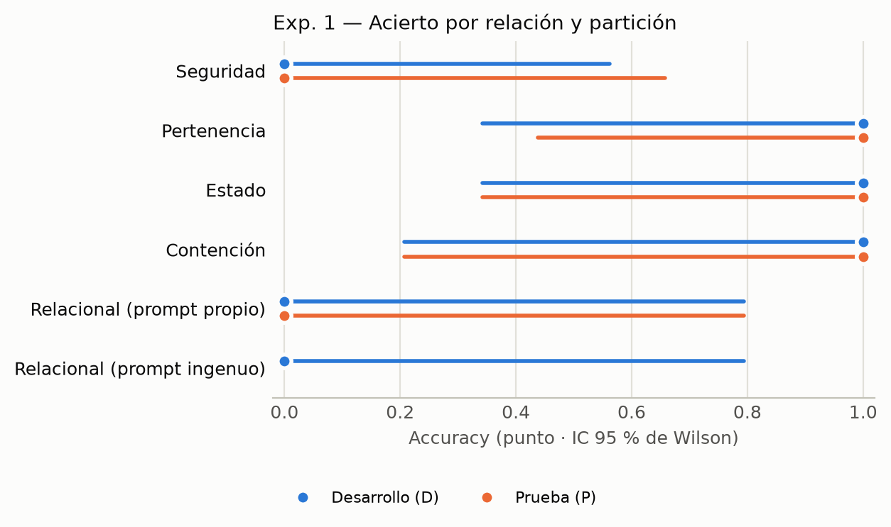

# Análisis LAB-IA-01B — generado por analisis_lab_ia_01b.py

Fuente: `/home/gabi__mora/LAB_F/burger_delivery/education/guias_laboratorio/plantilla_lab_ia_embodied/resultados/resultados.csv` (38 consultas, 19 con respuesta localizada) y `/home/gabi__mora/LAB_F/burger_delivery/education/guias_laboratorio/plantilla_lab_ia_embodied/verdad_terreno.csv` (29 filas de verdad de terreno).

## Avisos de calidad de los datos

- verdad_terreno.csv: 1 fila(s) sin caja u_min..v_max (agarre_s3); esas consultas no pueden contar como acierto.
- No existe espacio_trabajo.json: las Tablas 10b y 10c no validan el volumen.
- Exp. 1: Seguridad P tiene 2 repeticiones (mínimo 3).
- Exp. 1: Pertenencia D tiene 2 repeticiones (mínimo 3).
- Exp. 1: Estado D tiene 2 repeticiones (mínimo 3).
- Exp. 1: Estado P tiene 2 repeticiones (mínimo 3).
- Exp. 1: Contención D tiene 1 repeticiones (mínimo 3).
- Exp. 1: Contención P tiene 1 repeticiones (mínimo 3).
- Exp. 1: Relacional (prompt propio) D tiene 1 repeticiones (mínimo 3).
- Exp. 1: Relacional (prompt propio) P tiene 1 repeticiones (mínimo 3).
- Exp. 1: Relacional (prompt ingenuo) D tiene 1 repeticiones (mínimo 3).
- Exp. 3: dist1 registro=no tiene 1 consultas (mínimo 2).
- Exp. 3: dist2 registro=no tiene 0 consultas (mínimo 2).
- Exp. 3: dist3 registro=no tiene 0 consultas (mínimo 2).
- Exp. 3: dist4 registro=no tiene 0 consultas (mínimo 2).
- Exp. 3: dist5 registro=no tiene 0 consultas (mínimo 2).

## Tabla 3: Registro de escenas (capturas/*_meta.json)

| Escena | Color | % píxeles de profundidad válidos | Desfase color-prof. (ms) | Nota |
|---|---|---|---|---|
| agarre_i1 | 1920×1080 | 89.5 % | 41.5 | Igual que la anterior pero RETIRE la caja libre: solo queda la caja con el termo encima. |
| agarre_i2 | 1920×1080 | 88.2 % | 6.5 | Mano abierta a menos de 5 cm de la caja. SOLO la mano: sin anillos, reloj, tatuajes ni manga con logos. |
| agarre_i3 | 1920×1080 | 88.7 % | 43.8 | Caja volcada de lado o apoyada en un borde (inestable). |
| agarre_s1 | 1920×1080 | 89.7 % | 33.5 | Caja sola y libre, cerca del centro. |
| agarre_s2 | 1920×1080 | 87.4 % | 30.0 | Caja libre; termo y cuaderno a más de 10 cm de ella. |
| agarre_s3 | 1920×1080 | 90.6 % | 15.6 | Caja libre girada unos 45°, en otra zona de la imagen. |
| altura1 | 1920×1080 | 89.3 % | 23.3 | Caja sola sobre la mesa, cerca del centro. Mida su altura con la regla. h = 0.500 m |
| burger | 1920×1080 | 88.4 % | 14.7 | Una caja SOBRE la bandeja y la otra FUERA, a ~10 cm. |
| burgerp | 1920×1080 | 86.0 % | 12.8 | Bandeja al otro lado de la imagen; una caja sobre ella y la otra fuera en otra posición; termo como distractor. |
| dist1 | 1920×1080 | 87.5 % | 48.6 | Termo y caja cerca del centro de la imagen, a ~20–25 cm entre centros. d_horizontal = 25.000 m, dh = 0.000 m -> d = 25.000 m |
| dist2 | 1920×1080 | 86.8 % | 9.5 | Centro de la imagen, otra separación (~15 cm). d_horizontal = 15.000 m, dh = 0.000 m -> d = 15.000 m |
| dist3 | 1920×1080 | 87.8 % | 43.9 | Centro de la imagen, en diagonal o ~30 cm. d_horizontal = 15.000 m, dh = 0.000 m -> d = 15.000 m |
| dist4 | 1920×1080 | 88.8 % | 25.5 | Uno de los dos objetos CERCA DEL BORDE izquierdo de la imagen, sin salirse. d_horizontal = 15.000 m, dh = 51.000 m -> d = 53.160 m |
| dist5 | 1920×1080 | 89.3 % | 42.2 | Uno de los dos CERCA DEL BORDE derecho (o superior), sin salirse. d_horizontal = 15.000 m, dh = 51.000 m -> d = 53.160 m |
| exito_antes1 | 1920×1080 | 88.2 % | 39.2 | Caja FUERA de la bandeja, a ~10 cm. |
| exito_antes2 | 1920×1080 | 87.8 % | 37.9 | Otra posición inicial: caja y bandeja en lugares distintos a los de 'antes 1'. |
| exito_bien1 | 1920×1080 | 88.0 % | 42.5 | Meta a mano la caja DENTRO de la bandeja. Retire la mano antes de capturar. |
| exito_bien2 | 1920×1080 | 87.8 % | 19.0 | Caja DENTRO de la bandeja. Retire la mano. |
| exito_mal1 | 1920×1080 | 85.5 % | 41.3 | Vuelva al estado de 'antes 1' y deje la caja JUNTO a la bandeja (tocándola), no dentro. |
| exito_mal2 | 1920×1080 | 86.8 % | 15.3 | Desde 'antes 2': caja apoyada en el borde de la bandeja, medio afuera. |
| regla | 1920×1080 | 89.8 % | 50.2 | Hoja HORIZONTAL (lado largo de izquierda a derecha en la imagen), centrada y plana. Nada más sobre la mesa. Z = 1.000 m |
| semantica1 | 1920×1080 | 88.7 % | 20.4 | Cajas separadas ~10 cm. Termo de pie ENCIMA de la caja derecha; la izquierda queda libre. |
| semantica1p | 1920×1080 | 89.1 % | 56.8 | Cajas en otras posiciones (p. ej. en diagonal). Cuaderno encima de la caja IZQUIERDA. Bandeja vacía a un lado. |
| semantica2 | 1920×1080 | 90.3 % | 49.8 | Celulares separados ~15 cm; llaves pegadas (<3 cm) a uno de ellos. |
| semantica2p | 1920×1080 | 87.8 % | 6.7 | Celulares girados en otras posiciones; llaves junto al OTRO celular; esfero como distractor. |
| semantica3 | 1920×1080 | 87.1 % | 31.3 | Un cuaderno abierto (páginas en blanco) y otro cerrado. |
| semantica3p | 1920×1080 | 89.6 % | 14.8 | Posiciones intercambiadas (el abierto al otro lado); estuche como distractor. |
| semantica4 | 1920×1080 | 88.4 % | 20.5 | Un esfero DENTRO del estuche abierto; dos esferos sueltos fuera. |
| semantica4p | 1920×1080 | 86.8 % | 22.2 | Otro esfero dentro; uno apoyado SOBRE el borde del estuche (no dentro); uno suelto. |

## Tabla 4: Calibración de la cámara de color

| Parámetro | Valor | Fuente |
|---|---|---|
| Resolución de color (640x480) | 640x480 | default_color_calib_640x480.ini (kinova_vision) |
| f_x / f_y (px) | 653.7 / 651.9 | default_color_calib_640x480.ini (kinova_vision) |
| c_x / c_y (px) | 311.8 / 232.4 | default_color_calib_640x480.ini (kinova_vision) |
| Campo de visión horizontal (°) | 52.2 | 2·atan(W / 2f_x) |
| Resolución de color (1920x1080) | 1920x1080 | calibración rápida (regla: 0.297 m a 0.598 m) |
| f_x / f_y (px) | 1679.2 / 1679.2 | calibración rápida (regla: 0.297 m a 0.598 m) |
| c_x / c_y (px) | 960.0 / 540.0 | calibración rápida (regla: 0.297 m a 0.598 m) |
| Campo de visión horizontal (°) | 59.5 | 2·atan(W / 2f_x) |
| Distancia 3D entre esquinas de la hoja (m) | 1.0999 | resultados.csv fila 2-3 |
| Error de verificación respecto a 0.297 m (%) | +270.32 ⚠ > 5 % | 2026-11-09T19:53:22 |
| Distancia 3D entre esquinas de la hoja (m) | 0.2976 | resultados.csv fila 4-5 |
| Error de verificación respecto a 0.297 m (%) | +0.20 | 2026-11-09T21:27:06 |

## Tabla 5: Bitácora de desarrollo del prompt (solo escenas D)

| Iteración | Cambio en el prompt | Motivo (falla observada) | Aciertos en D | JSON inválidos |
|---|---|---|---|---|
| 0 | (describir) | (falla observada) | 3 / 5 | 0 |

Las columnas «Cambio» y «Motivo» se completan a mano desde la bitácora del grupo.

## Tabla 6: Experimento 1 — Semántica con partición (thinking = low)

| Relación | Aciertos D | Aciertos P | JSON inválidos (D + P) | Latencia media ± σ (s) | Observación del error | Filas CSV |
|---|---|---|---|---|---|---|
| Seguridad | 0 / 3 | 0 / 2 | 0 | 2.50 ± 0.91 | (describir) | 11, 20, 29, 12, 21 |
| Pertenencia | 2 / 2 | 3 / 3 | 0 | 3.19 ± 0.69 | (describir) | 13, 22, 14, 23, 30 |
| Estado | 2 / 2 | 2 / 2 | 0 | 3.08 ± 0.73 | (describir) | 15, 24, 16, 25 |
| Contención | 1 / 1 | 1 / 1 | 0 | 3.51 ± 1.04 | (describir) | 17, 26 |
| Relacional (prompt propio) | 0 / 1 | 0 / 1 | 0 | 3.67 ± 2.62 | (describir) | 27, 28 |
| Relacional (prompt ingenuo) | 0 / 1 | — | 0 | 40.58 | (describir) | 18-19 |
| Accuracy global (sin ingenuo) | D: 0.56 [0.27, 0.81] (N=9) | P: 0.67 [0.35, 0.88] (N=9) |  |  | Brecha D − P: -0.11 [-0.47, 0.29] (IC95 incluye 0: no se declara diferencia) |  |

Accuracy con IC 95 % de Wilson; brecha con intervalo de Newcombe.

## Tabla 7: Experimento 2 — Cajas delimitadoras

| Escena | Objeto | IoU medio ± σ con la verdad | σ de coordenadas (px) | IoU medio entre repeticiones | TP / FP / FN (IoU ≥ 0.5) |
|---|---|---|---|---|---|
| Global |  | mIoU: — |  |  | Precision: — · Recall: — |

## Tabla 8: Experimento 3 — Exactitud 3D y ablación del registro

| Config. | Posición en la imagen | d_real (m) | d_est con registro (m) | e con registro (mm) | d_est sin registro (m) | e sin registro (mm) |
|---|---|---|---|---|---|---|
| dist1 | centro | 25.000 | — | — (2 sin prof.) | — | — (1 sin prof.) |
| dist2 | centro | 15.000 | — | — (2 sin prof.) | — | — |
| dist3 | centro | 15.000 | — | — (2 sin prof.) | — | — |
| dist4 | borde | 53.160 | — | — (2 sin prof.) | — | — |
| dist5 | borde | 53.160 | — | — (2 sin prof.) | — | — |
| MAE / RMSE (N = 0 / 0) |  |  |  | — / — |  | — / — |

Ablación con la misma respuesta: 1/1 consultas pareadas.

## Tabla 9: Experimento 4 — Costo del razonamiento

| thinking_level | Accuracy | Latencia media ± σ (s) | Decisiones por minuto | Tokens de pensamiento (media) | Tokens totales (media) | ¿Aceptó el nivel? |
|---|---|---|---|---|---|---|
| low | — | — | — | — | — | sin consultas |
| high | — | — | — | — | — | sin consultas |
| minimal | — | — | — | — | — | sin consultas |
| medium | — | — | — | — | — | sin consultas |

## Tabla 10a: Matriz de confusión del agarre (positivo = insegura, se abstiene)

|  | Modelo se abstiene (lista vacía) | Modelo devuelve punto |
|---|---|---|
| Escena insegura | TP = 0 | FN = 0 |
| Escena segura | FP = 0 | TN = 0 |
| Precision / Recall / F1 | — / — / — | N = 0 |

## Tabla 10b: Espacio de trabajo y pre-agarre

_Sin datos todavía._

## Tabla 10c: Plan y detección de éxito

| Prueba | Resultado del modelo | Resultado esperado | ¿Correcto? | Comentario |
|---|---|---|---|---|
| Accuracy de detección de éxito | 0 / 0 |  | — |  |

## Tabla 11: Resumen de métricas (RAE 6.2)

| Métrica | Valor ± dispersión | N | Experimento | ¿Confirma la hipótesis de la Fase 1? |
|---|---|---|---|---|
| Accuracy semántica en D / en P | 0.56 [0.27, 0.81] / 0.67 [0.35, 0.88] | 9 / 9 | 1 | (contrastar) |
| mIoU y Precision / Recall de detección | — · — / — | 0 | 2 | (contrastar) |
| RMSE 3D con / sin registro (mm) | — / — | 0 / 0 | 3 | (contrastar) |
| Latencia low / high (s) | — / — | 0 / 0 | 4 | (contrastar) |
| Precision / Recall / F1 del rechazo de agarres inseguros | — / — / — | 0 | 5 | (contrastar) |
| Accuracy de detección de éxito | — | 0 | 5 | (contrastar) |

## Figuras

